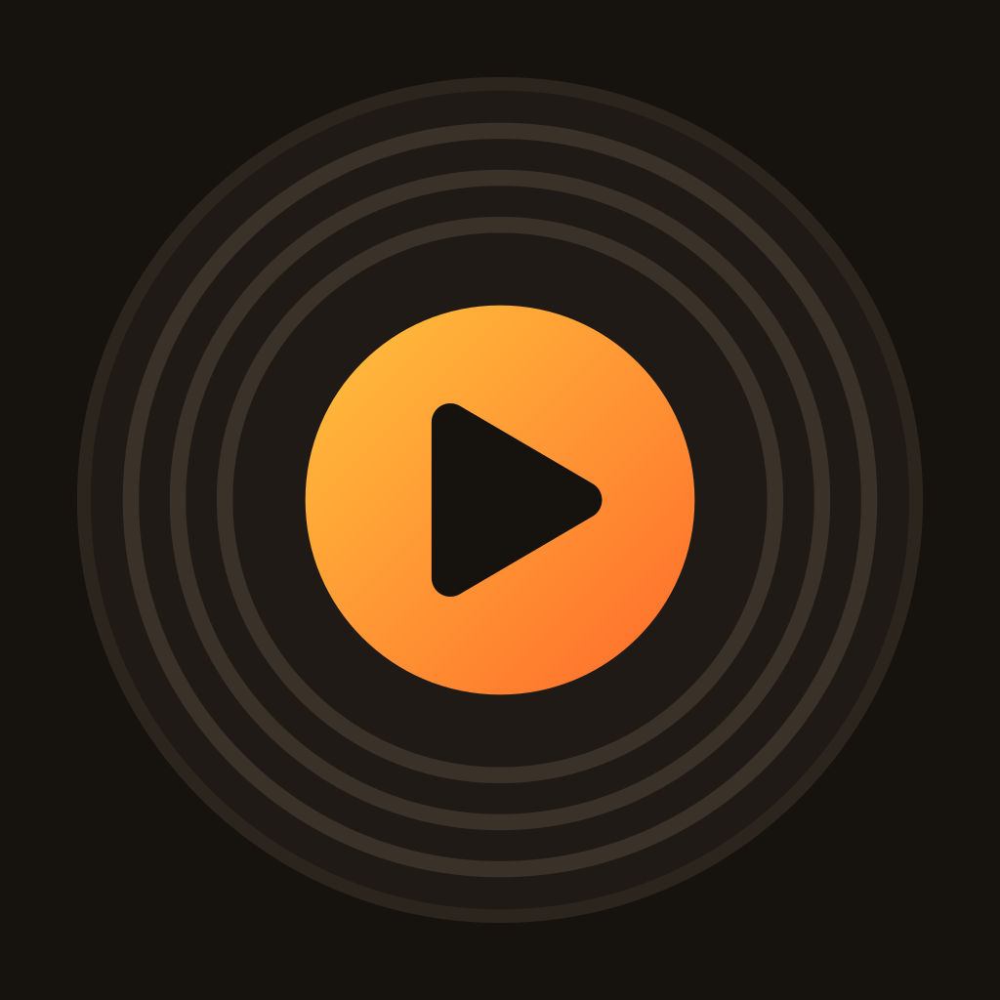

<div align="center">



# Prisma

**An open-source music client with a Material 3 Expressive interface.**

Monet colors, fluid animations, a full-screen player that follows your album art, and no ads,
subscriptions or tracking. Metadata, playlists and audio come from community plugins.

[Download the latest release](https://github.com/Gerocoo/Tubify/releases/latest) ·
[Support the project](https://paypal.me/gerocoo16)

</div>

---

## What it is

Prisma is a fork of [Spotube](https://github.com/team-spotube/spotube), the plugin-based music
client, for **Android and iPhone**. The playback engine and plugin system come from Spotube; the interface
has been redesigned from scratch around **Material 3 Expressive** and everyday Android conventions.

Everything Spotube already does is still there: plugins for any service, downloads with metadata,
synced lyrics, local files, Jam sessions with friends, no telemetry.

## Install

### Android

1. Open the [latest release](https://github.com/Gerocoo/Tubify/releases/latest).
2. Download the APK for your device: **`Prisma-arm64-v8a.apk`** for almost every recent phone
   (`armeabi-v7a` for old 32-bit phones, `x86_64` for emulators, `universal` if unsure).
3. Allow installing apps from your browser or file manager when Android asks.

Every build is signed with the same key, so a new APK always installs as an update. After the
first install you never need to come back here: Prisma updates itself (see
[In-app updater](#in-app-updater)).

### iPhone / iPad

Each release also contains **`Prisma-ios.ipa`**, unsigned. Install it with
[SideStore](https://sidestore.io), [AltStore](https://altstore.io) or Sideloadly, which sign it
with your own Apple ID. With a free Apple ID the app has to be refreshed every 7 days.

## Features

### Design

- **Material 3 Expressive everywhere**: pill buttons, large rounded surfaces, tonal containers and
  flat fills, with no glossy "glass" effects on press, focus or long press. The first-run setup
  follows the same design.
- **Material You (Monet)**: the whole app can take its colors from your wallpaper, or use one of
  the built-in accents (amber, blue, teal).
- **Light and dark themes** with checked contrast. The light theme is tinted with the accent color,
  like Pixel apps, and the status bar icons follow the app theme.
- **Figtree** typeface across the app, with heavy headings and clear hierarchy.
- **Outline icons** in a consistent thin style; play, pause, next and previous are solid.
- **Expressive loading indicators**: a morphing, scalloped spinner, a wavy progress bar and an
  Expressive pull-to-refresh.
- **Adaptive app icon**: a vector icon that fits every launcher shape, with a monochrome layer for
  Android 13+ themed icons. The same icon is used on iPhone, in the launch screen (light or dark
  with the system) and in the media notification.

### Navigation and motion

- **Floating navigation bar** (Home, Search, Your library, Create) with a Monet-tinted pill behind
  the active tab. When you switch tabs the pill slides across and stretches, then settles with a
  small bounce.
- **Shared-axis transitions** between tabs, in the direction of the tab you picked.
- **Predictive back** (Android 13+): pages, the full player and the lyrics shrink into a rounded
  card as you swipe back, and come back if you cancel.

### Home and library

- **Spotify-style home feed**: compact header, quick-access grid, shelves of mixes, albums and
  artists.
- **Year in review**: an annual listening recap built from your local history. It appears in the
  same season as the yearly recaps of the big streaming services, and stays hidden otherwise.
- **Library** with playlists, albums, artists, local tracks and downloads, all shown as rounded
  tonal cards like the album and playlist pages.
- **Liked songs** update instantly when you tap the heart.
- **Artist pages** with popular tracks, a *Show discography* button that lists every release, and
  a follow button that turns into *Following*.

### Track menu

- The three dots next to a track, or a **long press** on it in any list (playlists, albums, artist
  pages, search), open the same menu: like, add to playlist, queue, play next, go to album, go to
  artist, share, download.
- Tapping anywhere on a row plays the track; the artist page is reached from the menu or from the
  player.

### Playlists and albums

- Large artwork, a round play button and tracks shown as rounded cards.
- The **playing track** is tinted with the accent color and shows **animated equalizer bars**
  while it plays.
- **Morphing play button**: a circle when stopped, a rounded square while playing. On tap it
  squeezes, then keeps morphing and shows the Expressive loading shape until playback really
  starts, so a slow server never looks like an ignored tap.

### Player

- **Mini player** above the navigation bar, tinted with the album art, with like, previous,
  play/pause and next. Tap it or swipe it up to open the full player.
- **Container transform**: the mini player card itself grows into the full-screen player while the
  page behind shrinks, blurs and dims.
- **Album-art palette**: the full player, the mini player and the lyrics take their colors from the
  current cover, in both light and dark themes.
- **Cover carousel**: swipe the artwork left or right to skip. Covers slide in from the side you
  are going to, with the buttons too.
- **Expressive button group**: previous, play and next are large rounded buttons. The one you
  press widens while the others give way, then they spring back. Play/pause changes shape and
  shows a loading indicator while the stream buffers.
- **Wavy progress bar** and a title that scrolls when it is too long.
- Shuffle, repeat and like in one pill; sleep timer, track details and more in the options sheet.
- **Like from the notification**: the media notification and the lock screen have a heart button.

### Spotify Canvas and Spotify Connect

Both need the Spotify plugin, signed in with your account.

- **Canvas**: when a track has one, its looping video fills the player as on Spotify. It starts
  with the track (canvases of the next tracks are looked up in advance), a shadow under the title
  keeps text readable, and the buttons and the lyrics card take a blurred copy of the video as
  their background. It can be turned off in Settings → Playback.
- **Connect**: the button in the player lists your Spotify devices (desktop app, speakers, TVs).
  Pick one to continue the track there and control it from Prisma, or bring playback back to the
  phone.

### Queue

- **"Up next"** header with the number of queued tracks and a filter chip.
- Rounded track cards with a drag handle. The **dragged track lifts** (it grows, casts a shadow and
  turns tonal) while the others slide out of its way.
- The current track is marked with a round cover, an accent title and animated bars.
- **Floating toolbar** with shuffle, repeat and sleep timer, plus a button that unfolds
  *Find current track* and *Clear queue*.

### Lyrics

- Synced lyrics in a Pixel-style layout: large, left-aligned, heavy lines. The sung line is bright
  and the others fade with distance. Tap a line to seek.
- Colors from the album art, an Expressive *Synced / Static* toggle and previous / play / next
  controls at the bottom.
- The lyrics open over the player, which blurs and recedes behind them.

### Search

- Pill-shaped Material 3 search bars with a clear button, in Search, the library, the queue,
  playlists and settings.
- Recent searches and filter chips by type (tracks, playlists, albums, artists).

### Settings

- Grouped settings like Android's own: large outer corners, small inner ones, thin gaps.
- Material 3 switches with a check or cross in the thumb.
- Searchable language and region pickers that never slide under the status bar.
- Prisma follows the **system language** by default; the Italian translation is complete.

### Casting and Android Auto

- **Google Cast**: send what is playing to Chromecast, Google TV and Cast speakers on your Wi-Fi
  (Android 17's local-network permission is requested when needed). It can be turned off in
  Settings → Playback.
- **Android Auto**: Prisma exposes a browsable media library. Android Auto hides apps that do not
  come from the Play Store unless *Unknown sources* is enabled in Android Auto's developer
  settings, and some cars hide them anyway.

### In-app updater

- On launch Prisma checks this repository's releases. If a newer build exists it shows the release
  notes.
- **Update** downloads the right APK for your device (by ABI), shows the progress and opens
  Android's installer. *Cancel* stops the download.
- Settings → Updates → **Check for updates** runs the same check by hand and shows your installed
  build. Automatic checks can be turned off there.
- On iPhone the button opens the release page.
- **Plugins update themselves**: a new plugin version is installed in the background and a banner
  tells you which one and to which version. This can be turned off in Settings → Updates.
- Prisma implements **plugin API 0.1.0** and still runs plugins built for 0.0.x.

## Build from source

Prisma is a Compose Multiplatform (Kotlin) app. You need **JDK 21**, **Rust** (`rustup` +
`cargo`) and, for Android, the **Android SDK**.

```bash
# UI component library, published to mavenLocal
.github/scripts/build-ui-library.sh /tmp/ui-library-src

# Android
./gradlew :composeApp:assembleStableDebug
```

GitHub Actions builds every push to `master` / `tubify`:

- The **Android** job builds the signed per-ABI APKs, then publishes the release
  `build-<run number>`.
- The **iPhone** job builds the unsigned IPA and attaches it to the same release.
- The run number is also the app's `versionCode`, which is how the in-app updater knows a build is
  newer.

## Support

Prisma is free and has no ads, subscriptions or tracking. If you like it, you can support its
development with a voluntary donation on **[PayPal](https://paypal.me/gerocoo16)**. It is
entirely optional.

## Credits and license

Prisma is built on the work of
[Kingkor Roy Tirtho and the Spotube contributors](https://github.com/team-spotube/spotube). Like the
original project, it is licensed under **AGPL-3.0-or-later**: see [LICENSE](LICENSE).

The Figtree typeface is licensed under the [SIL Open Font License](assets/licenses/Figtree-OFL.txt).

Prisma is an independent project. It is not affiliated with, endorsed by or sponsored by Spotify,
YouTube, Google or their owners. All trademarks belong to their respective owners. Prisma does not
host any content; what you can play depends on the plugins you install and on the terms of the
services they connect to.
